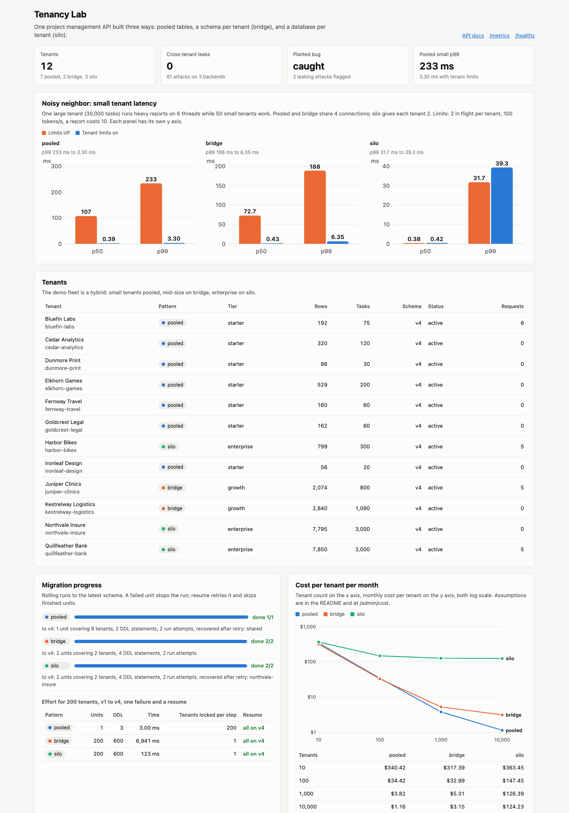

# Tenancy Lab

One small project management API (projects, tasks, comments, users, attachment metadata) built three ways behind a single repository interface: **pooled** (shared tables with a tenant_id column), **bridge** (a schema per tenant in one database server), and **silo** (a database per tenant with its own connection pool). The same FastAPI app runs all three side by side, so each tenant can live on whichever pattern fits it. A red-team suite tries to cross tenant lines through every endpoint, a load generator measures noisy neighbor latency, and the operations every SaaS team needs (rolling migrations, onboarding, offboarding, single-tenant backup and restore, a pooled to silo upgrade) run against all three with checksums. Everything runs offline on SQLite with synthetic data.



## Decision guide

| | Pooled | Bridge (schema per tenant) | Silo (database per tenant) |
|---|---|---|---|
| Isolation strength | Logical. One missed filter leaks data; needs a second layer (row level security). | Namespace. A query cannot name another tenant's table by accident, but one server and one credential. | Physical. Separate database, connection pool, and (in production) credentials and keys. |
| Cost per tenant at 1,000 tenants | $3.82/month | $5.31/month | $126.39/month |
| Ops effort | Lowest: one migration (1 unit, 3 DDL statements for 200 tenants). | Grows with tenants: 200 units, 600 DDL statements, and a catalog that slows every DDL (6.9 s for 200 schemas here). | Grows with tenants: 200 units and 600 DDL statements, plus a pool, backup and monitor per database. |
| Noisy neighbor risk | High: small tenant p99 went to 233 ms while one tenant ran reports. | High: same shared server, p99 188 ms. | Low: p99 32 ms with no limits at all. |
| Compliance fit | Weakest story for data residency, per-tenant keys, and "delete my data" proofs. | Middle: per-tenant dump and drop is easy, residency still shared. | Strongest: per-tenant region, encryption key, backup schedule, and verified deletion by dropping one database. |
| Per-tenant customization | None: everyone on the same schema version at the same time. | Possible: custom columns or a pinned version per schema. | Full: own version, extensions, maintenance window, instance size. |

**When to choose each.** Pooled for a long tail of small tenants where price per tenant matters and isolation is enforced twice (query layer plus row level security). Bridge for a few hundred mid-size tenants that need per-tenant restore or light customization, while the schema count stays far below what the catalog and migration tooling can handle. Silo for enterprise and regulated tenants that pay for it, ask for their own region or key, or would hurt everyone else with their load.

**Recommendation: hybrid.** Start every tenant on pooled with row level security, tenant-aware rate limits, and per-tenant concurrency caps. Offer silo as a premium tier and make the move a routine operation: this repo moves a tenant from pooled to silo with writes paused for the copy, checksums on every table, and an automatic abort that leaves the source untouched if anything differs. Keep the routing table (tenant to pattern) in a control plane so the app never cares where a tenant lives. That is how the demo fleet in the screenshot is set up: 7 pooled starter tenants, 2 bridge growth tenants, and 3 silo enterprise tenants, one of which was upgraded from pooled.

## Noisy neighbor results

One large tenant (30,000 tasks, about 42,000 comments) runs a heavy report on 6 threads in a loop while 50 small tenants each do normal work (get a task, list a project, search, add a comment) with 20 to 40 ms think time. Pooled and bridge share one pool of 4 connections, which stands in for one database server. Silo gives every tenant its own pool of 2. Each scenario runs 3 seconds. Latency is end to end for small tenants, including waiting for a connection.

| Pattern | Limits | Small p50 | Small p99 | Small tenant ops | Big tenant reports (rejected) |
|---|---|---:|---:|---:|---:|
| pooled | off | 107 ms | 233 ms | 1,111 | 77 (0) |
| pooled | on | 0.39 ms | 3.30 ms | 4,341 | 35 (130) |
| bridge | off | 72.7 ms | 188 ms | 1,403 | 124 (0) |
| bridge | on | 0.43 ms | 6.35 ms | 4,315 | 35 (177) |
| silo | off | 0.38 ms | 31.7 ms | 4,123 | 65 (0) |
| silo | on | 0.42 ms | 39.3 ms | 4,077 | 35 (164) |

The limits are one policy for every tenant: at most 2 requests in flight (half the shared pool), and a token bucket of 100 tokens per second where a report costs 10. In the shared patterns the big tenant can no longer hold all 4 connections, so small tenant p99 drops by 70x (pooled) and 30x (bridge), and small tenants get 3 to 4 times more work done. Silo does not need the limits for latency: the big tenant only saturates its own pool, and what remains is CPU contention on one laptop, which is why silo p99 sits at 30 to 40 ms in both runs (the difference between them is run to run noise). The price of the limits is the big tenant's throughput: 35 reports instead of 65 to 124.

Run on one Intel i9-9980HK laptop (8 cores), seed 7, from `make noisy`. Absolute numbers change between runs and machines; the ordering was the same in both full runs of the final code. Two calibration choices worth stating: the connection pool hands connections out first come first served (a pool where the releasing thread can grab its own connection back starved small tenants for the full 3 seconds, which is real but less typical), and the report query was written so that it uses indexes on every pattern, so the comparison is about isolation and not about a bad query plan.

## Why

Every B2B SaaS team picks a tenancy model early and lives with it. Pick pooled and one forgotten `WHERE tenant_id = ?` is a breach, and one customer's month-end report slows everyone. Pick silo and the bill and the migration runbook grow linearly with the customer count. Most teams end up hybrid, which means they need to move tenants between patterns safely. This repo makes those trade-offs concrete with numbers you can rerun.

## Architecture

```
  client ── Host: acme.tenancylab.test or X-Tenant-ID: acme
            Authorization: Bearer <token with tid claim>
        │
        ▼
 ┌──────────────── FastAPI ────────────────────────────────────────────┐
 │ resolve tenant (subdomain or header) and require token.tid to match  │ 400/401/403
 │ tenant limiter: token bucket + per-tenant concurrency cap            │ 429 Retry-After
 │ routes: projects, tasks, comments, attachments, search, export,      │
 │         reports, background jobs                                     │
 │ JSON logs with tenant_id, Prometheus /metrics per tenant             │
 └──────────┬───────────────────────────────────────────────────────────┘
            │ platform.repo(tenant)  (control plane: tenant -> pattern, status)
            ▼
     TenantRepo (one implementation of every query)
     ├── pooled: shared pool -> pooled.db
     │           query layer adds tenant_id = ?, TEMP views filtered by current_tenant(),
     │           TEMP triggers reject writes for any other tenant (SQLite stand-in for RLS)
     ├── bridge: shared pool -> server.db, tables namespaced per tenant (t_acme__tasks)
     └── silo:   one pool per tenant -> silo/<tenant>.db
```

| Piece | File |
|---|---|
| Tables and versioned migrations (v1 to v4), applied to any schema prefix | `src/tenancylab/schema.py` |
| The repository interface, written once | `src/tenancylab/repo.py` |
| The three backends and the pooled guard | `src/tenancylab/backends.py` |
| FIFO connection pool that records wait time | `src/tenancylab/db.py` |
| Control plane: routing, onboarding, offboarding, backup, restore, move, rolling migrations, jobs | `src/tenancylab/platform.py`, `registry.py` |
| Tokens and tenant resolution | `src/tenancylab/auth.py` |
| Rate limits and concurrency caps | `src/tenancylab/limits.py` |
| Red team | `src/tenancylab/redteam.py` |
| Noisy neighbor load generator | `src/tenancylab/noisy.py` |
| Migration effort benchmark and demo fleet | `src/tenancylab/ops.py` |
| Cost model | `src/tenancylab/cost.py` |
| API, admin endpoints, dashboard | `src/tenancylab/app.py`, `static/` |

Every table keeps a tenant_id column in all three patterns. In silo and bridge it is redundant, but it makes a tenant's rows identical wherever they live, so a move can be verified with the same checksums on both sides.

## How to run

```bash
cd tenancy-lab
uv sync --python 3.12
uv run pytest -q                      # 167 tests, about 10 seconds
make run                              # http://127.0.0.1:8875, seeds a demo fleet into ./data on first start
```

Call the tenant API with a token. The server and the CLI must share the signing secret:

```bash
export TENANCYLAB_SECRET=dev-secret-change-me TENANCYLAB_ADMIN_KEY=dev-admin
make run &
TOKEN=$(uv run tenancylab token --tenant bluefin-labs)
curl -s -H "Authorization: Bearer $TOKEN" -H "X-Tenant-ID: bluefin-labs" localhost:8875/api/projects
curl -s -H "Authorization: Bearer $TOKEN" -H "X-Tenant-ID: cedar-analytics" localhost:8875/api/projects   # 403
curl -s -X POST -H "X-Admin-Key: dev-admin" localhost:8875/admin/tenants/elkhorn-games/move -H 'content-type: application/json' -d '{"to":"silo"}'
```

Regenerate the results the dashboard and this README use:

```bash
make bench        # noisy neighbor (about 30 s), migration effort (about 12 s), red team
make gate         # the CI isolation gate on its own
make cost         # print the cost table
make screenshot   # headless Chrome, needs make run and Google Chrome
make check-mobile # fails if the page overflows sideways at 390 px
```

Admin endpoints: `GET /admin/tenants`, `/admin/migrations`, `/admin/migration-effort`, `/admin/noisy-neighbor`, `/admin/isolation`, `/admin/cost`, `/admin/events` are read-only and hold no tenant content. `POST /admin/tenants`, `DELETE /admin/tenants/{id}`, `GET /admin/tenants/{id}/export`, `POST .../backup`, `.../restore`, `.../move`, `.../token`, `POST /admin/migrations`, and `.../resume` need the `X-Admin-Key` header. Plus `/healthz`, `/metrics`, and `/docs`.

Docker files are built in CI only (Docker is not installed on the machine this was written on). The app runs the same way without Docker.

## Isolation red team

`src/tenancylab/redteam.py` creates a victim and an attacker on the same pattern, plants the string `CANARY-VICTIM-7f3a` in every victim table, and fires 27 attacks as the attacker: a forged `X-Tenant-ID`, a forged subdomain, a header that disagrees with the subdomain, a token with an edited tenant claim, an unsigned token, no token, IDOR reads and writes on every ID-taking route (get, list, patch, delete, post a comment, attachment, or task into the victim's objects), a `tenant_id` injected in a request body, list endpoints, bulk export, two searches, the report, a background job's result, and reading the victim's job by ID. A leak is any response that contains the canary or a victim ID, any denial route that returns 2xx, or any change to the victim's checksums.

| Run | Attacks | Leaks |
|---|---:|---:|
| pooled | 27 | 0 |
| bridge | 27 | 0 |
| silo | 27 | 0 |
| pooled with `TENANCYLAB_PLANTED_BUG=1` | 27 | 2 (search_canary, search_wildcard) |

The planted bug is a hand-written "fast path" search in the pooled backend that queries the base table directly and forgets the tenant filter, bypassing both the query layer and the guarded view. CI fails if any backend leaks, and also fails if the planted bug is not caught.

## Operations

- **Rolling migrations** run per unit with progress stored in the control plane. A unit is the shared database for pooled and one tenant for bridge and silo. Each unit migrates in one transaction, so a failure rolls that tenant's DDL back and leaves it on its old version. The run stops at the first failure; resume retries the failed unit and skips finished ones. For 200 tenants from v1 to v4 with a failure injected halfway: pooled 1 unit and 3 statements (but that one ALTER locks the shared tables for all 200 tenants), bridge 200 units and 600 statements in 6.9 s (every DDL rewrites a catalog that holds 2,200 objects), silo 200 units and 600 statements in 0.12 s.
- **Onboarding** is a registry row for pooled, a set of namespaced tables and indexes in the shared catalog for bridge, and a new database file for silo. **Offboarding** exports every row to a gzip JSON file with checksums, deletes, then verifies zero rows remain and no storage exists before marking the tenant deleted.
- **Backup and restore** work on one tenant without touching neighbors, verified by checksum after restore. A restore refuses a backup that belongs to another tenant.
- **Pooled to silo move**: pause writes (status `moving`, the API returns 503), copy, compare SHA-256 checksums for every table, flip the route, delete the pooled rows, and verify zero remain. A test corrupts one row in flight and checks that the move aborts, the partial silo is removed, and the source is unchanged.

## Cost model

Per tenant per month, from `src/tenancylab/cost.py`:

| Tenants | Pooled | Bridge | Silo |
|---:|---:|---:|---:|
| 10 | $340.42 | $317.39 | $363.45 |
| 100 | $34.42 | $32.99 | $147.45 |
| 1,000 | $3.82 | $5.31 | $126.39 |
| 10,000 | $1.16 | $3.15 | $124.23 |

Assumptions (all editable in one dataclass): a shared managed Postgres instance is $700/month and holds 2,000 pooled tenants or 500 bridge schemas; a dedicated silo instance is $60/month with a 20 GB minimum volume; 2 GB of data per tenant at $0.115/GB, backups at $0.095/GB; bridge adds 0.05 GB of catalog and index overhead per schema; 6 app pods keep a pool of 5 connections to every database, and a connection proxy ($90) is added per 5,000 connections once the total passes 5,000 (silo at 10,000 tenants needs 300,000 connections and 60 proxies); ops at $120/hour with 20 base hours, 0.5 hours per instance, 4 migrations a month at 0.5 hours each for pooled and 0.002 hours per schema or database for the others. At 10 tenants the patterns cost about the same because the base ops time dominates. The silo line flattens around $124 because almost all of it is the per-tenant instance.

## Tests

167 tests, about 10 seconds:

- Repository interface on all three backends: CRUD, updates, cascading delete, missing parents, cross-tenant IDs invisible, scoped search and lists, report counts, export and import with checksums, foreign rows rejected, and identical results when the same rows are loaded into all three.
- The pooled guard: raw cross-tenant UPDATE and DELETE are rejected by the triggers, the guarded view hides other tenants even from a query with no filter, and writes without a tenant context fail.
- Red team: 27 attacks on each backend as separate tests (81), every attack ran, and the planted bug is caught with only the search path leaking.
- Rate limits and concurrency caps: token bucket refill, report cost, per-tenant independence, the cap under 8 threads, queue timeout, and a short noisy neighbor run.
- Migrations: failure and resume on bridge and silo, the failed tenant rolled back, the single pooled unit, a runner killed partway, idempotent reruns.
- Operations: export and verified delete on each backend, backup and restore on each backend, move with checksums, an aborted move on a corrupted copy, writes blocked while moving, background jobs scoped to their tenant, and the demo fleet.
- Cost model math by hand, auth and tenant resolution, and the API end to end (each backend, subdomain routing, 429 with Retry-After, per-tenant metrics, admin key checks, admin operations, migration endpoints).

CI (`.github/workflows/ci.yml`) runs ruff, the tests, the isolation gate as its own job, then builds the Docker image and smoke tests it.

## Production notes

- Pooled would use Postgres row level security with `SET app.tenant_id` per transaction and a non-owner role, plus a lint rule or query builder that refuses raw SQL against tenant tables. The SQLite TEMP views and triggers here only imitate that.
- Bridge would be real Postgres schemas. Expect trouble past a few thousand: catalog size, autovacuum, pg_dump time, and migration tooling that iterates schemas. Shard schemas across servers before that.
- Silo would put each tenant in its own database or instance with its own credentials and KMS key, provisioned by Terraform from the control plane, behind PgBouncer or RDS Proxy.
- Rate limits and caps would live in Redis or in the gateway so they hold across app replicas; here they are in process. Heavy reports would go to a read replica or a queue with per-tenant fairness.
- The pooled to silo move would use logical replication or CDC to keep the write pause to seconds instead of a full copy window, and would keep the pooled rows for a grace period before deleting them.
- Tokens would come from an identity provider (OIDC) with the tenant claim set at login, not from an admin endpoint.

## License

MIT. See [LICENSE](LICENSE).
